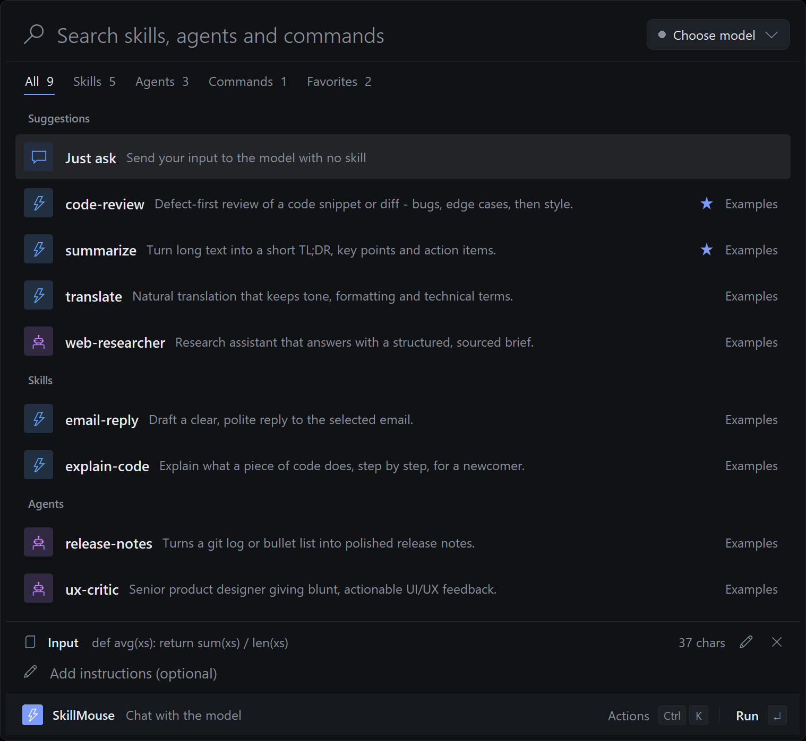
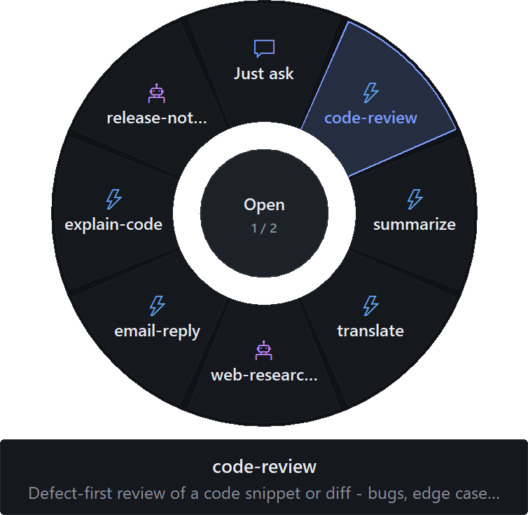
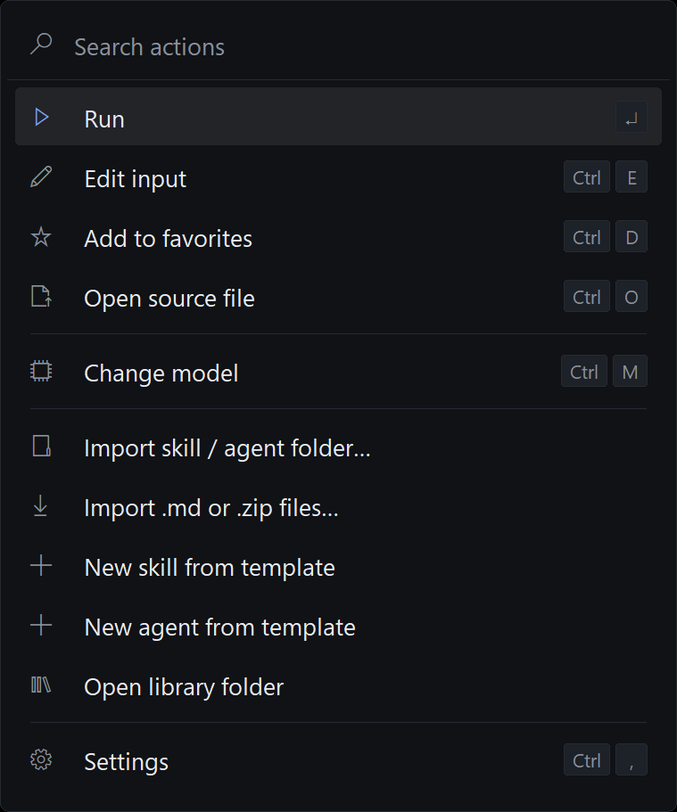
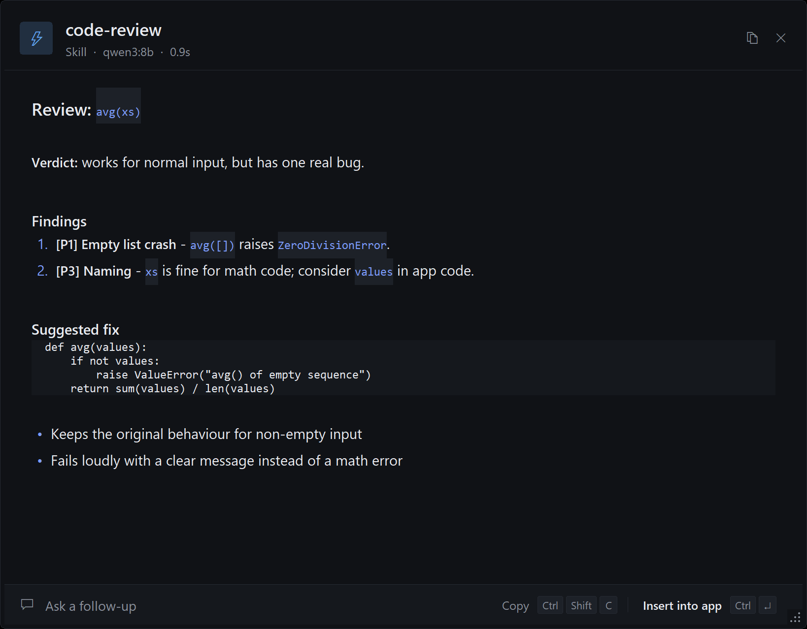
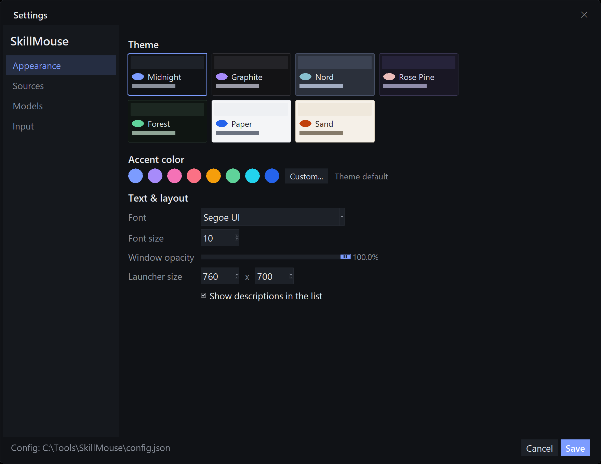

# SkillMouse

**Use Claude Code, Codex, OpenCode and Gemini skills and agents with *any* model - from your mouse.**

A lot of great open-source skills and agents are written only for Claude Code or Codex.
SkillMouse finds them on your PC and runs them on whatever model you like - OpenAI, Anthropic,
Gemini, OpenRouter, DeepSeek, Groq, or local models through Ollama / LM Studio.



## How it works

1. Select text anywhere (browser, editor, email...).
2. Press your mouse's **forward side button** or **Ctrl+Shift+Space**.
3. Search a skill or agent, press **Enter**. The answer streams in, nicely formatted.
4. **Insert into app** pastes it back where you were, or **Copy** / ask a follow-up.

### Drag gesture (donut)

Hold **Ctrl** and drag anything - selected text, files, images. A donut of your skills appears at the
cursor; drop on a slice to run it, or on the centre to open the launcher. Mouse wheel / **Tab** shows more.



Dropped files are read automatically: text and code, `.docx` / `.pptx` text, folders, and images
(sent to vision models).

## What it discovers

| Type | Where |
|---|---|
| Skills (`SKILL.md`) | `~/.claude/skills`, `~/.agents/skills`, `~/.codex/skills`, `~/.config/opencode/skills`, `~/.gemini/...`, plugins |
| Agents | any `agents/` folder (Claude, Codex, OpenCode, skill sub-agents) and persona folders with `SOUL.md` |
| Commands | `commands/`, `prompts/`, `workflows/` markdown (`$ARGUMENTS` = your instruction) |
| Rules | `CLAUDE.md`, `AGENTS.md`, `GEMINI.md`, `.cursorrules` |
| Library | anything you import (Ctrl+K > Import) |

Add any folder - e.g. a cloned GitHub skills repo - in **Settings > Sources**.
A skill's extra files (references, scripts) are bundled into the prompt up to a configurable budget.

## Install

Windows 10/11, Python 3.10+.

```powershell
git clone https://github.com/juw12/skillmouse
cd skillmouse
pip install tkinterdnd2        # optional: drag gesture + drag-and-drop
pythonw skillmouse.py          # or double-click "Start SkillMouse.cmd"
```

Models: set an API key (`OPENAI_API_KEY`, `ANTHROPIC_API_KEY`, `GEMINI_API_KEY`, `OPENROUTER_API_KEY`,
`DEEPSEEK_API_KEY`, `GROQ_API_KEY`) or paste it in **Settings > Models**. Ollama and LM Studio are detected
automatically. Optional autostart: `install-autostart.ps1`.

Try the bundled examples: **Settings > Sources > Add folder** and pick `examples/`.

## Keyboard

| Key | Action |
|---|---|
| `Enter` | run the selected skill |
| `Ctrl+K` | actions (favorite, import, change model, settings...) |
| `Ctrl+M` | switch model |
| `Ctrl+E` | edit the input text |
| `Ctrl+D` / `Ctrl+O` | favorite / open the skill file |
| `Ctrl+1..6` | tabs |
| `Ctrl+Enter` (result) | insert the answer into the app you came from |




## Customize

Seven themes, accent colour, font, size, opacity, mouse button, hotkey, drag modifier - **Settings** (`Ctrl+,`).



## Limits

Skills and agents run as **instructions** on the chosen model. Tools the original agent would call
(shell, file edits, web fetch, MCP) are not executed - the model is told to give you the exact step instead.
For fully agentic use of Claude Code with other models, look at routers such as claude-code-router or LiteLLM.

## CLI

```
python skillmouse.py --list                 # everything discovered
python skillmouse.py --models               # usable models
python skillmouse.py --prompt code-review   # the system prompt sent for a skill
python skillmouse.py --ask code-review --model ollama:qwen3:8b --text "def f(x): ..."
python skillmouse.py --import path\to\skill-or-agent
python skillmouse.py --selftest             # drives the real UI for ~30 s (moves your mouse)
```

## License

MIT
